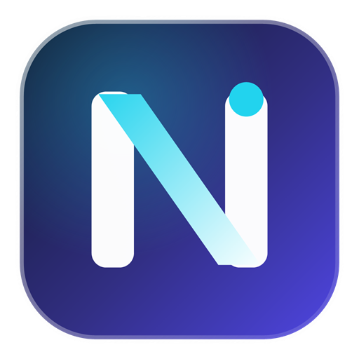
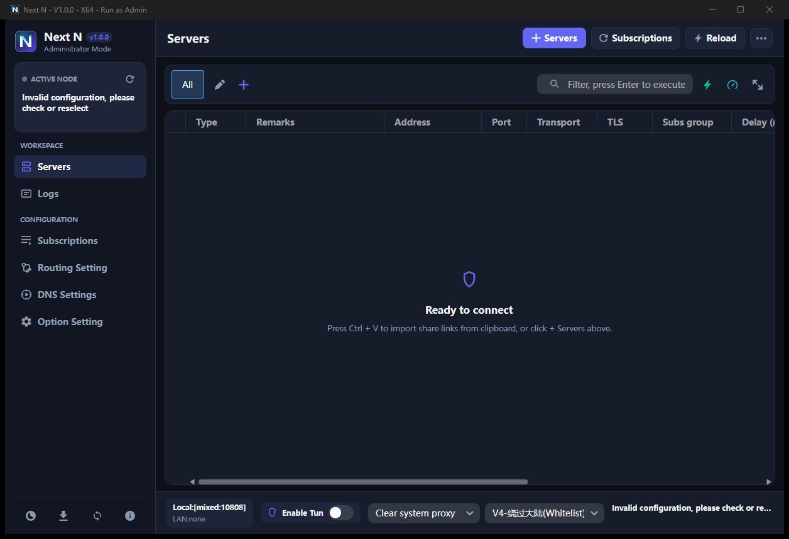

<p align="center">
  
</p>

<h1 align="center">Next N</h1>

<p align="center">
  <strong>A Modern, Re-Engineered Cross-Platform Network Proxy Client for Windows, macOS, and Linux</strong>
</p>

<p align="center">
  <a href="https://github.com/EbramJames/Next-N/actions/workflows/ci.yml">
    
  </a>
  <a href="https://github.com/EbramJames/Next-N/releases">
    
  </a>
  <a href="LICENSE">
    
  </a>
  
  
</p>

<p align="center">
  
  
  
</p>

---

## Overview

**Next N** is a sleek, high-performance desktop proxy client engineered on **.NET 10** and **Avalonia UI 12**, powering **Xray-core**, **sing-box**, and **mihomo** behind a clean, modern unified workspace.

Built for both everyday simplicity and advanced network engineering, **Next N** ships with native installers for every major operating system, bundled proxy cores and routing databases ready out-of-the-box, zero external ad links, and hardened architecture.

<p align="center">
  
</p>

## Highlights

- **Modern Unified Interface** — Clean sidebar navigation shell, live Active Node hero card, obsidian/indigo dark theme (with full light & accent palettes), modern bottom control dock, and zero menu bloat.
- **Native Cross-Platform Installers** — Real Windows Setup Installer (`NextN-Setup-x64.exe` with Start Menu, Desktop shortcut, Add/Remove Programs, clean uninstaller, and automatic upgrade process shutdown), macOS `.dmg`, Debian/Ubuntu `.deb`, Fedora/RHEL `.rpm`, and universal Linux `.AppImage` — plus Windows Portable `.zip`.
- **Out-of-the-Box Ready** — Installers automatically bundle the latest official **Xray-core**, **sing-box**, **GeoIP**, **GeoSite**, and **sing-box `.srs`** routing rulesets.
- **Full Protocol Coverage** — Supports `VLESS` (Reality / Vision / XHTTP), `VMess`, `Trojan`, `Shadowsocks`, `Hysteria2`, `WireGuard`, `TUIC`, `AnyTLS`, `Naive`, `MASQUE`, `SOCKS`, `HTTP`, Policy Groups, and Proxy Chains.
- **TUN Mode & Smart Routing** — One-click system-wide TUN mode, custom DNS & FakeIP rules, regional routing presets (Default / Iran / Russia), live connection monitor, and real-time throughput telemetry.
- **Re-Engineered Core** — Parameterized SQLite queries, self-contained Win32 global hotkey engine (no external git submodules), leak-free dynamic styling, consistent user-data isolation across normal and Administrator/TUN sessions, and `nextn://` URIs with seamless backward-compatible `v2rayn://` import.

---

## Downloads & Supported Platforms

Download the latest native installer for your operating system from the **[Releases Page](https://github.com/EbramJames/Next-N/releases)**:

| Operating System | Architectures | Package Format |
| :--- | :--- | :--- |
| **Windows** (10 / 11) | `x64`, `arm64` | Native Setup Installer (`.exe`) & Portable (`.zip`) |
| **macOS** (13+) | `arm64` (Apple Silicon), `x64` | Native Disk Image (`.dmg`) |
| **Linux** (Debian / Ubuntu) | `amd64`, `arm64` | Native `.deb` Package |
| **Linux** (Fedora / RHEL / Rocky) | `x86_64`, `aarch64` | Native `.rpm` Package |
| **Linux** (Universal) | `x86_64` | Portable `.AppImage` |

---

## Quick Start

1. **Install Next N** using the native installer for your OS (e.g., run `NextN-Setup-x64.exe` on Windows).
2. **Add your servers**:
   - Press **`Ctrl + V`** anywhere in Next N to import config links or subscription URLs from your clipboard, or
   - Click **`+ Servers`** in the top bar to import via QR code, image, or manual protocol editor.
3. **Connect**:
   - Double-click a server (or press **`Enter`**) to set it as active.
   - Switch **System Proxy** to *Set system proxy* or toggle **TUN** in the bottom control dock.

---

## Project Structure & Documentation

- **[Architecture Overview](docs/ARCHITECTURE.md)** — Solution layout, MVVM design, security hardening, and config isolation.
- **[Building & Packaging Guide](docs/BUILDING.md)** — How to compile from source, run unit tests, and build installers locally.

```text
Next-N/
├── src/
│   ├── NextN.Core/          # Shared proxy engine, protocols, routing, DNS, SQLite, ViewModels
│   ├── NextN.Desktop/       # Unified Avalonia 12 UI & platform services
│   ├── NextN.UdpTest/       # SOCKS5 UDP diagnostic suite
│   └── NextN.Updater/       # Process-safe self-updater & elevation helper
├── tests/
│   └── NextN.Core.Tests/    # Automated TUnit test suite
├── packaging/               # Windows NSIS, macOS DMG, and Linux DEB/RPM/AppImage builders
└── docs/                    # Technical documentation
```

---

## License & Attribution

**Next N** is free and open-source software licensed under the **[GNU General Public License v3.0](LICENSE)**.

- Maintained and re-engineered by **[EbramJames](https://github.com/EbramJames)**.
- Originally derived from v2rayN under GNU GPL v3.0 — see [NOTICE](NOTICE) for full attribution and modification details.
